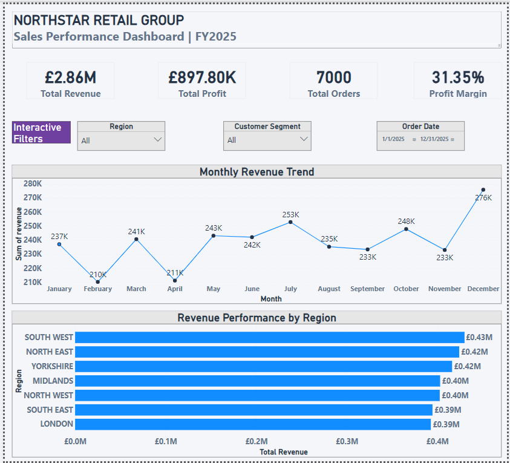
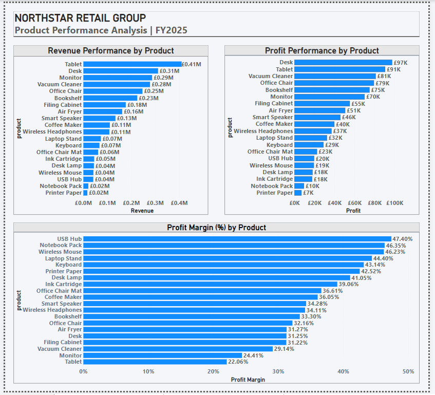
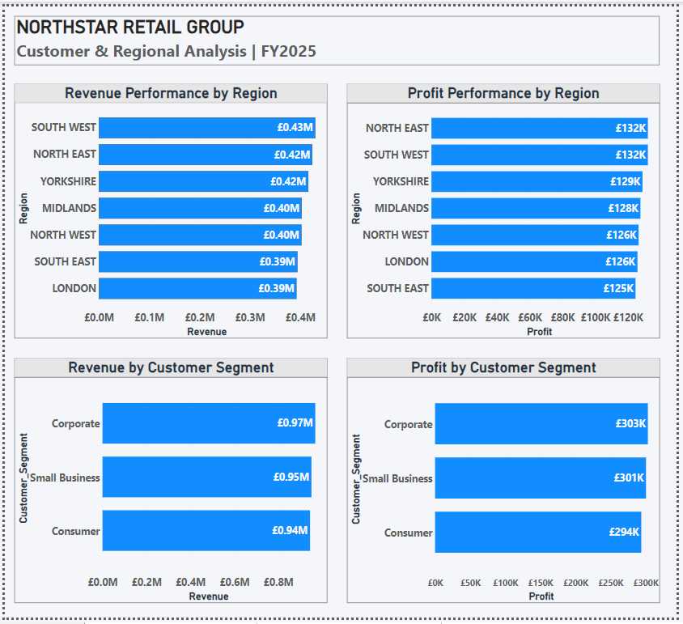
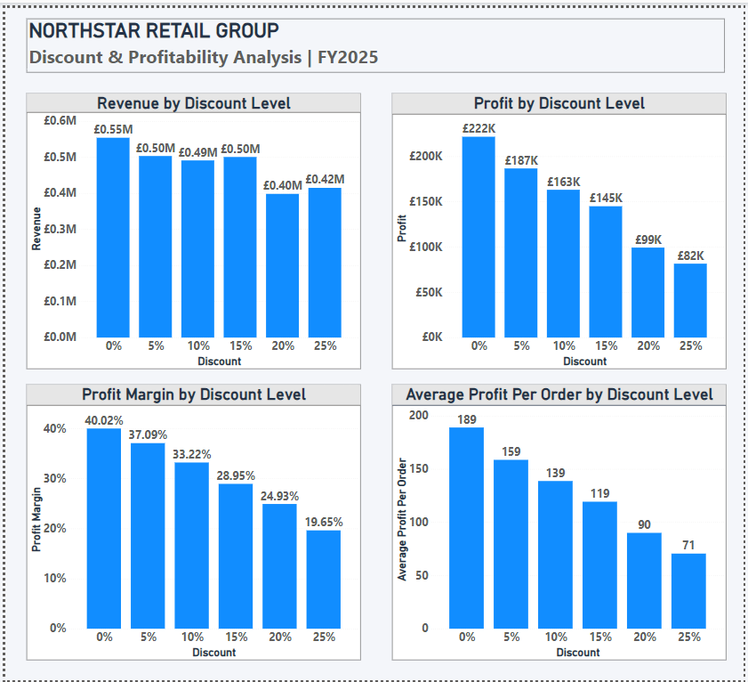

# NorthStar Retail Group — Power BI Dashboard

This folder contains the interactive Power BI sales performance dashboard developed for the NorthStar Retail Group FY2025 analytics project.

## Dashboard Overview

The dashboard contains four analytical pages:

### 1. Executive Overview

### 2. Product Performance

### 3. Customer & Regional Analysis

### 4. Discount & Profitability

## Tools and Technologies

- Microsoft Power BI Desktop
- Power Query
- Data Analysis Expressions (DAX)
- PostgreSQL

## Dashboard File

The complete Power BI report is available in this folder:

`NorthStar_Retail_Sales_Performance.pbix`
